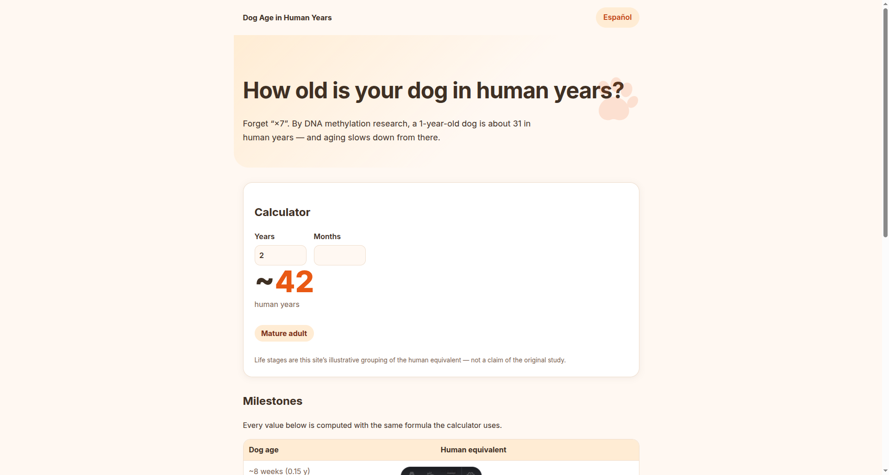
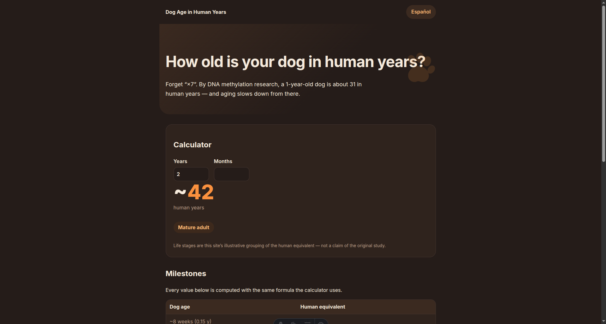

# Dog Age in Human Years

[](https://github.com/sandovaldavid/dog-age-web/actions/workflows/deploy.yml)
[](LICENSE)

**Science-based dog-to-human age translation — forget the “×7” rule.**

Bilingual (English / Español) web calculator that applies the epigenetic translation function published by Wang et al. (2020) in *Cell Systems*:

```text
human_age = 16 · ln(dog_age) + 31
```

A 1-year-old dog is about **31** in human years; a 12-year-old Labrador, about **70**. Aging is fast early and slows down later — a logarithm, not a constant multiplier.

**Live site:** https://sandovaldavid.github.io/dog-age-web/

| Light | Dark |
| --- | --- |
|  |  |

## Features

- Instant dog age → human equivalent (years + months input, live results)
- Milestones table computed at build time with the exact same formula as the calculator
- Life-stage chips (puppy / young adult / mature adult / senior) derived from the human equivalent
- English and Spanish routes (`/` and `/es/`) with proper `hreflang` alternates
- Warm playful theme with automatic dark mode
- Zero runtime dependencies — no tracking, no cookies, nothing leaves your browser
- Accessible: labeled inputs, `aria-live` results, visible focus, keyboard friendly, respects `prefers-reduced-motion`, WCAG AA contrast

> [!NOTE]
> This tool applies a published population-level function to the age you type. It does **not** analyze DNA, it is **not** a measurement of any individual dog, and it is **not** veterinary advice. The model was fitted on Labrador retrievers aged 0.15–16 years; other breeds can age differently.

## How it works

The study compared blood DNA methylation of 95 Labrador retrievers (0.1–16 years) with 320 humans (1–103 years) across 54,469 shared CpG sites, matching each dog to the average age of its five methylation-closest humans. The published fit is the logarithm above.

| Dog age | Human equivalent |
| --- | --- |
| ~8 weeks | ~0.6 |
| 1 year | ~31 |
| 2 years | ~42 |
| 7 years | ~62 |
| 12 years | ~71 |
| 16 years | ~75 |

## Development

Requires Node.js ≥ 20.

```bash
npm install
npm run dev       # dev server
npm run build     # production build to dist/
npm run test      # vitest (22 unit tests)
npm run check     # astro check
```

The formula lives in a single module ([`src/lib/dogAge.ts`](src/lib/dogAge.ts)) consumed by both the client script and the build-time milestones table. Copy for both languages lives in [`src/i18n/ui.ts`](src/i18n/ui.ts), where Spanish is type-checked against the English shape so a missing key fails the build.

## Deployment

Every push to `main` builds and deploys automatically via GitHub Actions (`withastro/action` + GitHub Pages). No manual steps.

## Citation

Wang T, Ma J, Hogan AN, Fong S, Licon K, Tsui B, Kreisberg JF, Adams PD, Carvunis A-R, Bannasch DL, Ostrander EA, Ideker T. *Quantitative Translation of Dog-to-Human Aging by Conserved Remodeling of the DNA Methylome.* Cell Systems. 2020;11(2):176–185.e6. [doi:10.1016/j.cels.2020.06.006](https://doi.org/10.1016/j.cels.2020.06.006)

Educational project by David Sandoval — not affiliated with the study authors or publishers.
